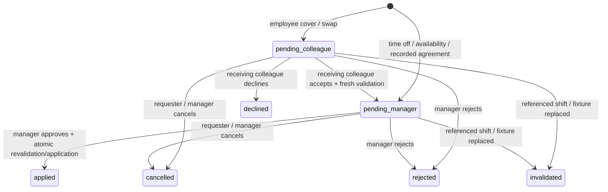

# Milestone 4 — local employee workflows

Implemented in `/Users/annarodriguez/.codex/local-projects/shiftflow`, outside iCloud. All identities, employees and agreements are fictional. No Strobbo connection, publication, outbound email or WhatsApp delivery is implemented.

## Try the flow

Start the local engine (`npm run engine:dev`) and frontend (`npm run dev`) in separate terminals. The first visit opens as fictional manager Jamie de Boer. Use **Employee portal** or the **Fictional demo identity** selector to switch to an employee. This is an openly selectable local identity simulation, not real authentication. Nothing is ready for real accounts or deployment.

The existing manually authored fixtures deliberately contain skill gaps. For an eligible end-to-end example, first use Schedule → Generate & compare and save a feasible roster; choose an employee with saved shifts. No existing roster is automatically replaced by this milestone.

1. Employees see only their own draft assignments, profile, availability, absences, requests, incoming offers and addressed notifications. Competencies are visible but cannot be self-certified.
2. **Find cover or swap** evaluates colleagues or return shifts in the selected/adjacent stored weeks. It removes/reassigns the original shift before checking the complete proposal, so it cannot count the departing closer or supervisor. Both directions of a swap are checked together. Every option is labelled eligible or ineligible with reasons; hard eligibility is separate from hour-preference ranking. No eligibility is shown if required engine checks fail to complete. Assessments show their source revision and have a Recheck control.
3. Send a cover offer or bilateral swap to a specific colleague. Availability, qualification, skilled coverage, trainee supervision, existing assignments, rest, breaks and working-time rules are checked again. Submission does not alter the roster.
4. Only the receiving colleague can accept or decline. Acceptance freshly checks the proposal and moves it to manager review. The requester may cancel while it is pending. The manager can reject it.
5. In **Requests**, the manager reviews the offered/return assignments and chooses **Review approval → Revalidate & apply now**. The server checks the reviewed workspace revision and request version, confirms source assignments still match, rebuilds operational inputs from current server data and independently validates affected and adjacent stored weeks. It checks both sides of a swap under the same transaction lock.
6. A valid approval atomically saves assignments, terminal request state, approver ID/time, applied revision, before/after audit evidence and addressed local notification events. A failed check or stale revision leaves all of them unchanged. Overlapping pending offers whose source assignments changed are invalidated with history and notifications. Already final requests cannot be applied twice.
7. Employees can request time off, recurring/date-specific availability and preferred hours. These wait for manager approval; approval cannot silently remove an assigned worker. Conflicting assignments must be rearranged first. Approved date-specific exceptions override recurring windows, while approved absences take precedence over availability. Skills remain manager-owned.
8. **Record agreed change** lets the manager record an explicitly confirmed agreement (for example an in-person or WhatsApp agreement). It requires both-party consent confirmation and an audit note, then independently validates and applies the change atomically. It never reads or sends WhatsApp messages.

Local notifications and per-request transition history are available to the relevant employee and manager. Marking a notification read changes only the local read receipt. All applied requests explicitly say **Applied in ShiftFlow — Strobbo not connected**. The calendar and CSV reflect the new assignments. Weeks affected by an approved operational change require full engine validation for subsequent calendar changes too.

## Data and interfaces

Workspace schema v2 gains backward-compatible optional `requests` and `notifications` arrays. Existing workspaces are preserved and default to empty arrays. Employees gain optional `availabilityOverrides: [{date, window|null}]`; the TypeScript validator and Python workspace adapter both honor these. A week may carry `validationPolicy: 'full-engine'` in addition to the existing solver provenance.

Each request has a stable UUID, optimistic version, requester, creation/update timestamps, note, complete transition history and `externalSync: 'not_connected'`. Shift requests retain original assignment snapshots, intended recipient, optional reciprocal assignment and source (`employee` or `manager-recorded`). Applied records add `approvedBy`, `approvedAt` and `appliedRevision`. Time-off and availability requests retain the exact proposed dates/windows/preferences. No subjective performance rating is stored.

States:

The actual API uses hyphenated state strings (for example `pending-colleague`). Approval and application form one atomic local operation, not two separately committed states.

- `GET /api/demo-session`: current demo actor and fictional account choices; a first visit creates the default manager demo session.
- `POST /api/demo-session`: explicit fictional identity selection. An opaque HttpOnly, SameSite=Strict cookie references a private local session record with a 24-hour expiry. Anyone who can access this local demo can select the manager; it is not an authentication product.
- `GET /api/workforce`: manager request/notification feed or employee-scoped portal projection.
- `GET /api/workforce?view=candidates&mode=cover|swap&week=YYYY-MM-DD&shiftId=...`: complete replacement assessments for an owned shift (or manager assessment).
- `POST /api/workforce`: strict discriminated commands `create-shift`, `create-time-off`, `create-availability`, `accept`, `decline`, `cancel`, `approve`, `reject`, `record-agreement`, `read-notification`. Commands use expected workspace revision and request version where relevant. Client actor IDs, approval timestamps, certification claims and status fields are not trusted.
- Existing workspace, planning and legacy shift-cover APIs are manager-gated at the server. Missing demo sessions return 401, employee attempts return 403. Loopback/same-origin boundaries remain enforced.

All data operations use one shared, process-wide serialized workspace queue and atomic file rename. Engine validation happens inside the approval transaction before any write. The engine receives operational projections only, excluding request/notification/audit history. The Python service remains stateless with respect to the manager workspace. One Node process is supported; production database transactions and authenticated actor/membership checks remain Milestone 5.

Audit history is no longer truncated to 100 events. Fixture resets preserve historical requests/audit/notifications and invalidate active requests rather than making old offers applicable to new shifts. Local JSON history is persistent but is not tamper-proof or an immutable production audit log. No external notification outbox or sync receipt is fabricated.

## Manager assumptions to confirm

- Whether cover offers should be targeted (implemented) or openly claimable; whether both-party consent is required for manager-recorded agreements (implemented).
- Whether employees should see draft assignments before formal publication; this portal explicitly labels them local drafts.
- Cancellation/decline deadlines, expired or past shifts, and notification/response expectations. This fictional demo does not automatically expire requests or impose a wall-clock cutoff.
- Which time-off categories, approvers and effective dates are needed. The demo supports date lists, not leave balances or statutory entitlement decisions.
- Recurring availability changes currently apply to all stored assignments and future generation; approval checks existing affected weeks conservatively. Effective-dated recurring rules and historical rule versions require pilot design.
- Operational skill minima, supervisor capacity, contractual minimum hours and working-time defaults documented in Milestone 3 still need manager/qualified-reviewer confirmation before real use.

## Verification

`npm run check`, `npm run engine:test`, `npm run build`, `npm run test:api`, `npm run test:planning`, and `npm run test:workforce` (the last two require the engine running). Integration suites use isolated temporary workspaces and the production Next server with the actual independent Python validator. Workforce cases cover role/ownership boundaries, candidate reasons, colleague acceptance, concurrent/cross-route approval races, fresh availability/qualification/rest changes, trainee supervision, both-direction swap qualification, source/version staleness, overlapping offer invalidation, cancellation/rejection/decline, notification scoping, time off, dated availability, manager-recorded consent, restart persistence and audit evidence.

Browser verification exercised cover and bilateral swap submission → colleague acceptance → manager application, visible approval history, an explicit time-off failure with no application, eligibility refresh and the employee portal/dialog at 390px without horizontal overflow. All browser data is isolated from the project workspace.
